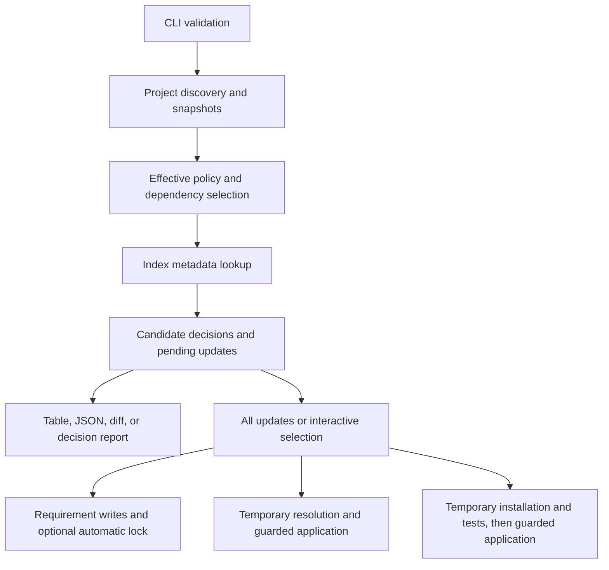

# Architecture

[README](../README.md)

check-updates is a native Rust CLI. It reads dependency requirements, selects newer releases from index metadata, and prepares requirement edits. Dependency resolution is a separate step delegated to uv. Installation and test execution occur only in explicit Doctor mode.

This guide describes implementation structure. See [Workflows](workflows.md) for command sequences and [Development](development.md) for build and release procedures.

## Execution structure

`src/main.rs` parses and validates CLI arguments, collects update decisions, and selects the output or application path. `src/lib.rs` exposes the implementation modules and shared interrupt handling.

Discovery and metadata lookup finish before the interactive selector or any project write. A read-only command stops at reporting. A write command with no pending updates does not start locking, verification, or Doctor trials.

## Module responsibilities

| Module | Responsibility |
| --- | --- |
| [`main.rs`](../src/main.rs) | CLI validation, policy coordination, collection, reporting, and application dispatch |
| [`workspace.rs`](../src/workspace.rs) | Project discovery, original-byte snapshots, workspace dependency exclusions, and index source routing |
| [`dependencies.rs`](../src/dependencies.rs) | Dependency occurrences, requirement parsing, supported edits, and version-change labels |
| [`policy.rs`](../src/policy.rs) | Saved settings, configuration inheritance, package filters, and member selection |
| [`selection.rs`](../src/selection.rs) | Python metadata baseline, candidate eligibility, minimal edits, and rejection reasons |
| [`indexes.rs`](../src/indexes.rs) | HTTP metadata access, index authentication, retries, release links, and caching |
| [`locked.rs`](../src/locked.rs) | Read-only registry version context from `uv.lock`, without a freshness check |
| [`output.rs`](../src/output.rs) | Update tables and the base JSON update schema |
| [`interactive.rs`](../src/interactive.rs) | Terminal selection and default-No confirmation |
| [`changes.rs`](../src/changes.rs) | Exact replacement bytes, diff previews, snapshot checks, ordinary writes, and diagnostic text handling |
| [`locking.rs`](../src/locking.rs) | Default post-write `uv lock` and the parent-workspace guard |
| [`verification.rs`](../src/verification.rs) | Supported-layout checks, temporary resolver inputs, exact-version resolution, lock validation, and guarded application |
| [`doctor.rs`](../src/doctor.rs) | Temporary source copies, installation, test trials, bounded subset selection, and Unix process-group cleanup |

## Data flow

The command keeps discovery, candidate selection, and application data separate:

1. `workspace::Project` holds a project path, parsed TOML document, and original bytes.
2. `dependencies::Dependency` identifies one requirement by its section path and dependency-array index.
   - Repeated package names remain separate occurrences.
3. `indexes::Release` holds a version and artifact metadata used for eligibility checks.
4. `selection::Decision` records the selected candidate, observed stable and prerelease versions, and rejection reasons.
5. `dependencies::Update` holds an occurrence, replacement requirement, target version, and optional links.
6. `output::Pending` groups updates by project.
7. `changes::Change` holds the prepared output bytes for one project.

`changes::prepare_change` uses source spans to replace selected requirement values in the original text. It does not rewrite the whole TOML document. Diff display normalizes line endings for readability; application uses the prepared bytes, not the displayed diff.

## Selection and resolution

Candidate selection does not solve a dependency graph. It applies requirement bounds, target limits, Python metadata, and release policies to index artifacts. Package and section filters apply before metadata requests. Workspace member selection limits edits while the workspace root remains available for source and resolver context.

A shared `ReleaseClient` reuses metadata during one invocation. Public PyPI metadata can also use a persistent cache. Private-index metadata remains in memory. See [Package indexes](indexes.md) for routing, authentication, and cache rules.

Resolution uses uv through one of three paths:

- Default locking runs after ordinary requirement writes, when an eligible lockfile exists.
- Verification resolves selected versions in a temporary project before application.
- Doctor uses verification inputs, installs dependencies, and runs the supplied test command before application.

`verification::Prepared` owns temporary inputs and snapshots. Resolution produces `verification::Verified`, which contains the validated lockfile and the manifest edits it resolved. Application checks that the supplied requirement changes match those verified edits.

## Side effects and safety boundaries

- Read-only checks do not write project inputs or run uv. They can access the network and write the public metadata cache.
- Ordinary writes check affected requirement snapshots before the first write. Files are then written sequentially; this is not a transaction.
- Verified application checks resolver inputs and attempts guarded recovery on write failure. Recovery does not overwrite concurrent user edits.
- Doctor executes project and dependency code with the user's permissions. Its temporary project is not an OS security sandbox.
- Interrupt handling uses a shared atomic flag. Network and child-process paths check cancellation; an interrupt returns exit code `130`.

The full write, recovery, and child-process guarantees are defined in [Locking, verification, and Doctor](locking.md). Index credential rules are defined in [Package indexes](indexes.md), not by the diagrams in this guide.

## Tests

Unit tests are colocated with Rust modules. Integration tests in `tests/` cover CLI output, process behavior, cancellation, formatting preservation, verification, and Doctor. Index tests use local HTTP fixtures; resolver tests use temporary projects and inert artifacts.

See [Development](development.md) for required checks. Tests must not run update or Doctor commands against this repository or a real user project.

## Related documentation

[Workflows](workflows.md) · [Update policies](policies.md) · [Output and limitations](reference.md)
