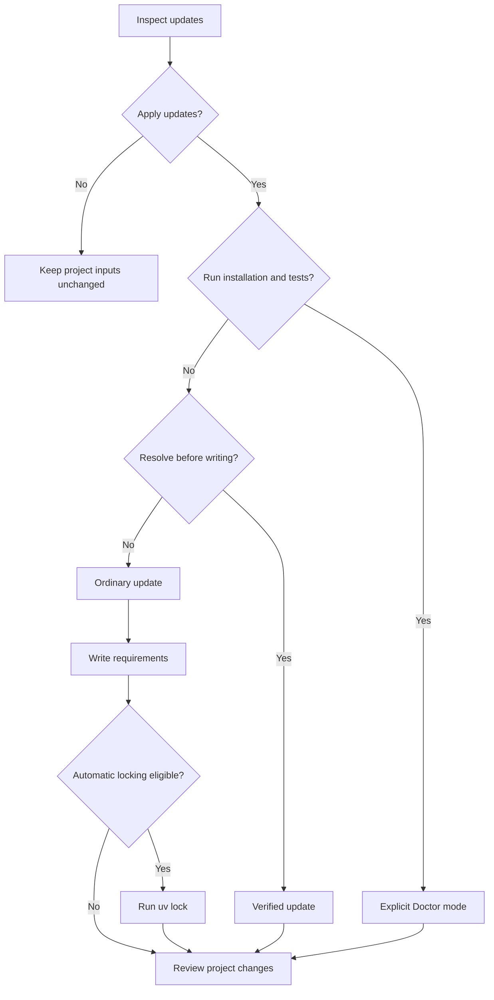

# Workflows

[README](../README.md)

Start with a read-only check, review the proposed changes, then choose how to apply them. Requirement edits, lock resolution, installation, and tests are separate operations. Only Doctor combines installation and tests with update selection.

Run the examples in the project directory that contains `pyproject.toml`. Add `-w` for a uv workspace; workspace commands can also start from a member or member subdirectory. See [Usage](usage.md) for all options and interactive controls.

## Choose an application path

| Goal | Command | Project effects |
| --- | --- | --- |
| Inspect updates | `uvx check-updates` | No project writes |
| Preview exact requirement edits | `uvx check-updates --diff` | No project writes |
| Choose updates manually | `uvx check-updates -i` | Selected requirements; automatic locking when eligible |
| Apply all selected updates | `uvx check-updates -u` | Selected requirements; automatic locking when eligible |
| Change requirements only | `uvx check-updates -u --no-lock` | Requirements only |
| Resolve before applying | `uvx check-updates -u --verify` | Verified requirements and lockfile |
| Install and test before applying | `uvx check-updates -u --doctor --test-command uv run --no-sync pytest` | Tested subset and lockfile; installation and tests run in a temporary project |

The table describes successful application. Preconditions and failure handling are defined in [Locking, verification, and Doctor](locking.md).



The diagram shows application choices, not every option rule. Bounds require verification when written. With an existing lockfile and without `--no-lock`, cooldown or prerelease policies also use verification rather than ordinary post-write locking.

## Review and apply selected updates

```sh
# Inspect the available updates and their exact edits.
uvx check-updates
uvx check-updates --diff

# Select occurrences, preview their diffs, and confirm.
uvx check-updates -i
```

All entries start unchecked. Final confirmation defaults to No. Empty selection or cancelled confirmation leaves project inputs unchanged. The command checks affected files against their original snapshots before ordinary writes.

To restrict the scope, use the same filters for inspection and application:

```sh
uvx check-updates --target patch --group dev --exclude pytest --diff
uvx check-updates -i --target patch --group dev --exclude pytest
```

Separate invocations can observe different releases or project contents. The interactive preview shows the selection that will be applied by that invocation.

After application, review requirement and lockfile changes in version control. Normal updates do not install packages. Run `uv sync` when ready to install the resolved dependencies, then run your project's tests.

## Update requirements without locking

```sh
uvx check-updates -u --no-lock

# Run later, when ready to resolve and install.
uv lock
uv sync
```

`--no-lock` requires `-u` or `-i`. It cannot be combined with explicit verification, Doctor, or bound replacement. Release policies still filter requirement candidates, but this path provides no lockfile or transitive-policy guarantee.

## Resolve before writing

```sh
uvx check-updates -i --verify
```

Verification requires uv, an existing regular lockfile, and a supported static virtual project or workspace. It does not support arbitrary build projects. Check the [supported layouts and resolver restrictions](locking.md#verified-updates) before choosing this path.

The command resolves exact selected versions in a temporary project and validates the resulting lockfile. In interactive mode, resolution succeeds before final confirmation. A failure or cancellation before application leaves original inputs unchanged. A successful resolution is not a runtime compatibility test.

For custom indexes, use project index configuration and named-index environment credentials. Lookup-only `--index` overrides and embedded URL credentials are not accepted by verification or Doctor. Implicit public PyPI needs no index configuration.

## Test updates with Doctor

```sh
# Unix only; put --test-command last.
uvx check-updates -u --doctor --test-command uv run --no-sync pytest
```

Use Doctor only with trusted projects, dependencies, uv executables, and test commands. It executes code with your permissions and can use the network. The temporary copy is not an OS security sandbox.

Doctor follows this sequence:

1. Copy supported project inputs into a temporary project.
2. Resolve, install, and test the baseline.
3. Resolve, install, and test the complete candidate batch.
   - If it fails, try bounded subsets.
4. Freshly resolve and re-test the final combined subset.
5. Apply only that verified and tested subset after snapshot checks.

Doctor does not sync the original project environment. Its search is bounded, and an observed test pass does not prove compatibility. See [Doctor updates](locking.md#doctor-updates) for scope, limits, and failure behavior.

## Check updates in CI

```sh
# Read-only structured report across a workspace.
uvx check-updates -w --format json --check

# Add candidate decisions and unverified lockfile context.
uvx check-updates -w --explain --show-locked --format json --check
```

Exit code `3` means requirement edits are available in the selected scope. Exit code `0` means no edits are available; blocked newer versions alone do not cause exit code `3`. Errors use other exit codes and must not be treated as a successful no-update result.

Plain JSON uses schema version 1. `--explain` or `--show-locked` selects schema version 2. See [Output and limitations](reference.md#automation-and-previews) for fields and [Exit codes](reference.md#exit-codes) for the complete exit contract.

## Handle a failed application

First identify the path that failed:

- Lookup or pre-application verification failed: no project updates were applied.
- Ordinary requirement writing failed: earlier files can already contain updates.
- Default automatic locking failed: requirement edits remain; the lockfile can be stale or changed.
- Verified application failed: guarded recovery is attempted, but concurrent edits can prevent complete recovery.

Review the reported paths and the version-control diff. For an automatic-lock failure, correct the cause and run `uv lock` in the reported root. Restore only intended paths if reverting changes. Do not overwrite concurrent user edits or assume multi-file application is transactional.

See [Locking, verification, and Doctor](locking.md) for the authoritative write and recovery guarantees.

## Related documentation

[Architecture](architecture.md) · [Usage](usage.md) · [Update policies](policies.md) · [Package indexes](indexes.md)
